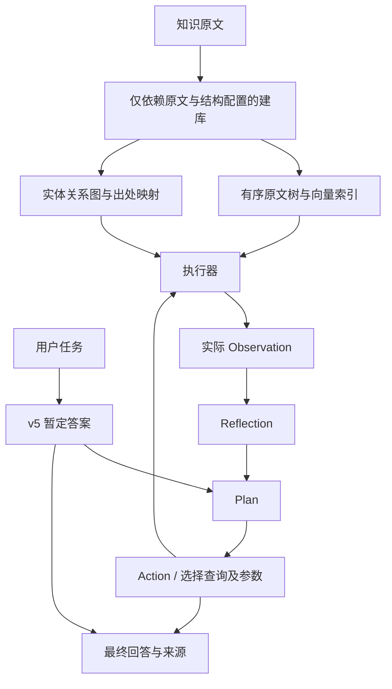

# RePAR: ReAct over Parametric Retrieval

**面向自有知识库的通用研究与问答 agent。** RePAR 将有序原文树、实体关系图和可组合的查询 API 结合起来，由语言模型根据任务与实际观察自主检索、反思并作答。

更新时间：2026-11-28 01:04，Asia/Shanghai。当前推荐版本：**RePAR v5**。

## RePAR v5

v5 先生成一份暂定答案，再围绕影响结论的疑点进入研究循环。模型可以查询树、实体、关系或原文，也可以在认为信息充分时直接作答。最终回答同时参考先验草稿和已取得的来源证据。

- **有序原文树**：按 EmbeddingGemma tokenizer 分块，保留文本顺序、字符区间和出处，结合语义向量定位与回读原文。
- **实体关系图**：用 spaCy 抽取实体、概念和带出处的关系，为跨片段定位提供线索；当前配置包含中英文后端。
- **参数化查询**：通过树浏览、树搜索、实体搜索、邻居查询和原文读取组合研究步骤。
- **执行后反思**：先执行工具取得 Observation，再生成 Reflection；执行器负责参数、重复调用与资源预算约束。
- **可复核记录**：保留先验草稿、模型调用、工具参数、来源切片、token 用量与终止原因。

RePAR 的核心接口处理普通知识任务。MATH 和 LongBench 是评测适配场景；题型、标准答案与评分不参与索引构建。参数化指查询算子的可配置参数；当前实现没有模型权重训练或跨任务自我训练。

## 架构



原文片段 `C` 与实体/概念 `E` 为多对多映射，陈述 `P` 和关系 `R` 保留原文出处。图边用于定位与组合材料；自动抽取的边和路径本身不能当作已证明的逻辑结论。

设计与维护约定见 [AGENTS.md](AGENTS.md)，v5 机制见 [先验草稿与自主研究设计](docs/2026-11-26_1707_RePARv5先验草稿与研究工作台.md)。

## 最终 v5 实验结果

冻结条件：**求解 seed 42，Direct answer 上限 8,192 tokens，768-token 分块索引**。最终作答上限保持 MATH `4096`、LongBench `128`。0.8B 和 27B 的 v5 结果均已完成全量覆盖与运行审计；baseline 使用归档的同种子结果，未在汇总阶段重新运行。

- **MATH**：2025 年全国Ⅰ卷 19 题。表中为实验折算分 `/150`，括号内是整题全对数 `/19`，不是官方阅卷成绩。
- **LongBench**：LongBench v2 **Multi-Document QA 的 125 题子集**，表中为准确率及正确题数。
- `-` 表示没有该条件的结果。

| 方法 | 0.8B · MATH | 27B · MATH | 0.8B · LongBench | 27B · LongBench |
|---|---:|---:|---:|---:|
| 直接回答 | 31.333/150（2/19） | 132.333/150（15/19） | 21.6%（27/125） | 51.2%（64/125） |
| BM25 RAG | 41.000/150（6/19） | 139.167/150（16/19） | 23.2%（29/125） | 46.4%（58/125） |
| RAPTOR | 26.000/150（5/19） | - | 21.6%（27/125） | - |
| HippoRAG2 | - | - | 1.6%（2/125） | - |
| HyperGraphRAG | - | - | 28.0%（35/125） | - |
| **RePAR v5** | **40.667/150（6/19）** | **138.333/150（17/19）** | **28.0%（35/125）** | **36.8%（46/125）** |

### v5 token 消耗

| 基模 | Benchmark | 在线输入 token | 在线输出 token | 建库 LLM token | 合计 token |
|---|---|---:|---:|---:|---:|
| 0.8B | MATH | 930,363 | 140,918 | 0 | 1,071,281 |
| 0.8B | LongBench | 5,547,870 | 177,543 | 0 | 5,725,413 |
| 27B | MATH | 170,750 | 75,132 | 0 | 245,882 |
| 27B | LongBench | 2,951,524 | 175,488 | 0 | 3,127,012 |

完整的 24 个模型/benchmark/方法组合、baseline 建库成本与来源说明见 [最终指标总表](docs/2026-11-27_2019_v5双底座最终结果与基线指标汇总.md)。机器明细见 [JSON](artifacts/repar_v5_final_20261127/summary_with_27b.json) 和 [CSV](artifacts/repar_v5_final_20261127/summary_with_27b.csv)，最终配置登记见 [final_results.json](configs/v5/final_results.json)。

### 统计口径与限制

- token 合计为在线输入、输出加一次历史建库的生成式 LLM token，**不含阅卷和 embedding**。baseline 在线列为复用归档证据后的作答成本；v5 在线列包含草稿、控制和最终作答。
- v5 使用 EmbeddingGemma 与 spaCy，建库 LLM token 为 0；仍有嵌入、抽取与索引计算成本。按嵌入 tokenizer 计，原文正文规模为 MATH **633,724**、LongBench **17,478,760** tokens，不代表完整 embedding 执行计量。两个底座共用冻结索引。
- **27B 的 MATH 19 题全部自主选择未检索**，其成绩不能归因为检索收益。27B LongBench 实际执行 126 次工具调用，47/125 题未检索；两套评测均无生成错误、控制修复或整次请求缓存命中。
- LongBench 的 RAPTOR、HippoRAG2、HyperGraphRAG 分别有 4、116、4 题缺少可复用证据，按错误计入 125 题分母。
- MATH 基线使用既有全题型 27B 阅卷；v5 的选择题走解析评分，其他题型由 27B 阅卷。27B MATH 使用冻结的模型推荐采样（温度 0.7 等），LongBench 温度 0.1。判分和模型特定采样的差异均保留。
- 这些 benchmark 此前已参与开发；结果为单种子开发评测，不代表未见测试确认或稳定的多种子收益。27B v5 的 LongBench 准确率低于本表的 27B Direct 与 BM25。

## Webserver 启动与使用

工作台支持知识库上传、会话问答、原文出处、真实执行轨迹及 2D/3D 图谱。完成后文的环境安装后，在仓库根目录运行：

```powershell
python -m webserver.server --port 8080
```

打开 `http://127.0.0.1:8080/studio` 进入知识问答，`/studio/libraries` 管理知识库，`/` 查看本地保存的评测案例。**普通启动不需要历史归档，不自动重建评测数据，也不调用模型。保存位置有数据就加载，没有就显示空列表。**

| 本地位置 | 自动加载的内容 | 不存在时 |
|---|---|---|
| `artifacts/studio_v5/` | 已保存的知识库、会话、问答与调用记录 | 空工作台，可新建知识库 |
| `webserver/data/` | 已导出的评测案例与可视化缓存 | 评测页显示暂无结果，问答和建库不受影响 |
| 本地兼容的冻结示例索引 | 可用的 MATH / LongBench 示例库 | 不显示对应示例库，不阻止服务启动 |

实际上传建库时才需要嵌入与 spaCy 模型，提交问答时才需要 LLM 服务。上传支持一份或多份 UTF-8 文本，PDF/Office 文档需先转文本。原文、索引和问答保存在工作台目录，重启后继续读取；可指定其他保存位置和模型：

```powershell
python -m webserver.server --port 8080 --studio-config configs/repar_v5.local.json --studio-root artifacts/my_workspace
```

默认监听回环地址，适合本地单用户使用。导出历史评测页面是独立的离线命令，详见 [工作台说明](webserver/README.md)，不是启动前提。

## 配置文件与运行参数

### 选择底座与服务

| 用途 | 配置文件 | 模型别名 | 服务地址 | 配置的上下文窗口 |
|---|---|---|---|---:|
| 默认工作台 / 0.8B 普通知识任务 | [repar_v5.json](configs/repar_v5.json) | `Qwen3.5-0.8B-Q4_K_M` | `http://127.0.0.1:9091` | 262,144 |
| 0.8B 冻结求解条件 | [solver_768_42_direct8k.json](configs/v5/solver_768_42_direct8k.json) | 同上 | 同上 | 262,144 |
| 27B 求解条件 | [solver_768_42_direct8k_27b.json](configs/v5/solver_768_42_direct8k_27b.json) | `Qwen3.8-27B-UD-Q4_K_M` | `http://127.0.0.1:9090` | 131,072 |

模型名称是现有本地服务的实际别名。客户端使用 `/v1/chat/completions`、`/tokenize`、`/detokenize`，以及 JSON/GBNF 约束；更换服务时应核对这些能力。复制一份配置，修改 `base_url`、`model`、`deployment_id` 和实际 `context_window`，再通过 `--studio-config` 或研究命令的 `--config` 使用：

```powershell
Copy-Item configs/repar_v5.json configs/repar_v5.local.json
# 如使用 27B，改为复制它的求解配置到本地文件
# Copy-Item configs/v5/solver_768_42_direct8k_27b.json configs/repar_v5.local.json
```

配置 `context_window` 不会扩充服务实际容量。0.8B 的现有 Windows CUDA 启动脚本为：

```powershell
powershell -File scripts/serve_local.ps1 -Port 9091 -ContextSize 262144 -Parallel 1
```

该脚本使用 `models/Qwen3.5-0.8B/Qwen3.5-0.8B-Q4_K_M.gguf` 和本地 llama.cpp；每个并发槽位的上下文为 `ContextSize / Parallel`。当前 v5 使用标准权重，不启用历史 MTP 开关。27B 连接已有兼容推理服务，仓库未提供专用的 27B 启动脚本。

### 温度、采样与 token 预算

| 配置字段 | 默认 v5 值 | 含义 |
|---|---:|---|
| `seed` / `temperature` | `42` / `0.1` | 默认随机种子与温度 |
| `enable_thinking` | `false` | 传给服务的聊天模板思考开关 |
| `direct_answer_max_tokens` | `8192` | 检索前暂定答案的输出上限 |
| `answer_max_tokens` | `4096` | 普通知识任务最终答案的输出上限 |
| `plan_max_tokens` / `action_max_tokens` | `256` / `128` | 单次 Plan / Action 输出上限 |
| `reflection_max_tokens` | `768` | 单次执行后 Reflection 输出上限 |
| `react_max_steps` / `no_progress_patience` | `4` / `2` | 研究轮数预算与连续无进展容忍次数 |
| `evidence_token_budget` | `7000` | 累积证据输入预算，不是输出 token 上限 |
| `controller_evidence_tokens` / `observation_evidence_tokens` | `3200` / `3200` | 控制器 / 观察使用的证据输入预算 |
| `read_page_chars` | `3200` | 单页回读原文的字符数 |

采样参数可放在 `sampling`（所有调用）、`control_sampling`（结构化控制调用）、`answer_sampling`（非结构化草稿/回答调用）中，支持 `temperature`、`top_p`、`top_k`、`min_p`、`presence_penalty`、`frequency_penalty`、`repeat_penalty`。实际覆盖顺序为：**根级 `temperature` → `sampling` → 适用的角色采样对象**。例如，`sampling` 中设置 `top_p` 为 `0.8`，会用于所有调用；`answer_sampling` 中的同名参数只覆盖非结构化调用。没有配置的采样字段不发送，由真实服务默认值决定；不要把服务默认值当成客户端已明确冻结的参数。

Benchmark 的实验配置与通用工作台配置分开。0.8B 使用 [experiment_768_42_direct8k.json](configs/v5/experiment_768_42_direct8k.json)；27B 使用 [experiment_768_42_direct8k_27b.json](configs/v5/experiment_768_42_direct8k_27b.json)，其中 MATH 的采样为温度 `0.7`、`top_p=0.8`、`top_k=20`、`min_p=0`、`presence_penalty=1.5`、`repeat_penalty=1`，LongBench 温度为 `0.1`。两套评测的最终输出分别限制为 `4096` 和 `128`；LongBench 使用四选一 GBNF，MATH 使用自由文本。**8K 只指 Direct answer 草稿，不是所有阶段的统一上限。**阅卷模型另设温度 `0`、输出上限 `3072`，不与求解侧混计。

### 嵌入与知识结构

将完整的 `google/embeddinggemma-300m` 快照放到 `models/EmbeddingGemma-300M/`。来源、逐文件版本和 SHA256 见 [模型来源清单](models/EmbeddingGemma-300M/source_manifest.json)。实际建库时校验清单及模型文件，不会自动下载权重。

| 配置字段 | 默认值 / 作用 |
|---|---|
| `embedding.path` | `models/EmbeddingGemma-300M`，本地模型目录 |
| `embedding.manifest_sha256` | 与实际来源清单 SHA256 一致，防止混用嵌入版本 |
| `embedding.build_device` / `embedding.query_device` | 默认 `cuda`，可按硬件改为 `cpu` |
| `embedding.batch_size` | `16`，嵌入批量大小 |
| `chunk_max_tokens` / `tree_fanout` | `768` / `4`，原文分块上限与树分支数 |
| `retrieval_top_k` / `graph_neighbors` | `8` / `6`，候选检索与图邻居预算 |

保留默认配置中的其他控制与索引参数。更换模型、解码设置或索引时使用新的部署/实验标识，不将不同条件写入同一份结果或缓存。

## 环境安装

要求 Python **3.11 或更高版本**。以下以 Conda 和 PowerShell 为例，在仓库根目录执行：

```powershell
git clone https://github.com/wudejian789/RePAR.git
cd RePAR
git lfs install
git lfs pull --include='data/longbench_v2.json'
conda create -n RePAR python=3.11 pip -y
conda activate RePAR
python -m pip install -e '.[agent-v4,dense-index,graph,dev]'
python -m spacy download en_core_web_sm
python -m spacy download zh_core_web_sm
```

依赖与可选组件以 [pyproject.toml](pyproject.toml) 为准。按本机硬件安装对应的 PyTorch 构建；默认 v5 配置使用 CUDA，也可以将嵌入构建和查询设备设为 `cpu`。

仅浏览空工作台或已保存的记录，可先 `python -m pip install -e .`，无需下载模型。实际建库/问答再安装上面的可选依赖并准备模型。LongBench 使用 Git LFS 保存；未安装 Git LFS 时可用 `python scripts/download_assets.py --dataset-only` 下载固定版本并校验 SHA256。完整 `download_assets.py` 还会下载 0.8B 标准/MTP 历史权重和 Windows CUDA llama.cpp，**不包含 EmbeddingGemma 或 27B 权重**，无需为了普通工作台下载全部历史资产。

## 在自己的知识库上运行

准备一份 UTF-8 文本 `knowledge.txt`，然后运行：

```powershell
python scripts/research_kb_v5.py --config configs/repar_v5.local.json --context knowledge.txt --task '归纳文档的主要论点，并为每条结论给出来源。' --output artifacts/my_research.json
```

命令会构建或复用该知识库的索引，打印最终回答，并将来源、轨迹和调用记录写入指定 JSON；阶段事件保存在相邻的 `.events.jsonl` 文件中。索引和请求缓存位于 `artifacts/`。

### 只建库，不生成答案

Web 的知识库上传流程会独立完成建库。Python 中也可以直接调用实际的 v5 索引接口：

```python
from pathlib import Path
from repar.dense_index import DenseKnowledgeIndex
from repar.io import read_json

config = read_json('configs/repar_v5.local.json')
context = Path('knowledge.txt').read_text(encoding='utf-8-sig')
index = DenseKnowledgeIndex.cached(context, config, directory='artifacts/indexes_v5')
print(index.stats)
```

该 API 仅接收原文和结构配置，不传题目或标准答案。CLI 的 `artifacts/indexes_v5` 与 Web 的工作台持久化目录用途不同，CLI 缓存不会自动注册为 Web 知识库；希望在网页管理的资料请从知识库管理页上传。

### 独立 baseline

BM25 可独立处理普通任务；仅做检索时不需要作答模型，也不构建 RePAR 的树或图：

```powershell
python -m baselines.BM25_RAG --context knowledge.txt --task '研究任务' --retrieve-only
```

RAPTOR、HippoRAG2、HyperGraphRAG 的来源、固定上游版本、可选依赖和接口见 [baselines/README.md](baselines/README.md)。其他 baseline 的依赖约束与 v5 的 `dense-index` 不完全兼容，建议使用独立环境，按各方法说明安装。

## 复现与审计

运行自由知识任务只需要准备模型和自己的原文。**重放这里的历史 benchmark 条件还需要原始数据、冻结索引、源码快照及完整运行归档**；仓库中的轻量汇总与审计结论不能代替这些材料。

恢复对应归档后，使用显式配置运行：

```powershell
# 0.8B，seed 42
python scripts/run_repar_v5.py --config configs/v5/experiment_768_42_direct8k.json --workers 1
python scripts/audit_repar_v5.py --run artifacts/repar_v5_direct8k_20261127/seed_42

# 27B，seed 42；求解和阅卷串行使用既有 27B 部署
python scripts/run_repar_v5_27b.py --config configs/v5/experiment_768_42_direct8k_27b.json
python scripts/audit_repar_v5.py --run artifacts/repar_v5_27b_direct8k_20261127/seed_42 --reference artifacts/repar_v5_direct8k_20261127/seed_42 --backbone-reference artifacts/repar_v4_r27_27b_20261120
```

审计覆盖逐题唯一 ID、评分、真实请求与预算、原文切片、索引/源码哈希及 Observation 后 Reflection 的事件顺序。历史材料只对应其冻结版本，不能作为后续任意源码状态的实测结论。

## 目录结构

```text
src/repar/       通用 agent、知识结构、查询 API 与模型接口
baselines/       独立对比方法、来源记录与评测适配
configs/         通用配置、模型连接与冻结实验条件
scripts/         建库、研究、评测、审计与报告命令
tests/           核心组件行为与集成测试
webserver/       知识问答工作台、评测展示和浏览器测试
docs/            设计、实验报告和带时间的维护日志
models/          本地模型权重；Git 仅保留来源清单
data/            数据与许可元数据；LongBench 固定快照经 Git LFS 发布
artifacts/       索引、预测、轨迹和缓存；Git 仅保留精选结果摘要
third_party/     上游源码、提示与来源记录，遵循各自许可
```

## 测试

```powershell
python -m pytest tests -q
python -m pytest webserver/tests -q
```

浏览器测试需要 Playwright 与 Chrome/Edge 或 Playwright Chromium，细节见 [工作台验证说明](webserver/README.md#数据与验证)。部分历史集成检查依赖完整的本地模型与实验材料；缺少依赖的跳过项不能算作验证通过。

## 仓库内容与许可

Git 仓库保留源码、配置、文档、第三方许可、模型/数据下载清单和精选结果摘要。**LongBench v2 的 503 题原始固定快照已通过 Git LFS 纳入仓库**，其中本项目评测使用 125 题 Multi-Document QA 子集；来源、校验和与数据许可见 [数据说明](data/README.md)。

模型权重、运行请求缓存、用户会话、生成的网页数据和大体积索引保留在本地。MATH 教材分块及试卷/参考解答尚未确认再分发许可，不上传全文，也不能声称仅克隆仓库即可复现历史 MATH 归档。资源清单与明确的保留范围见数据说明。Web 默认启动与这些历史资源无关。

项目整体许可证尚未指定。第三方代码、模型和数据各自遵循原作者许可；未发现再分发许可的 CoT-RAG/T3 上游快照不纳入发布，不能将其视为已实现并可复用的 baseline。

## 更多文档

- [文档与维护日志索引](docs/README.md)
- [v5 机制与原始对照](docs/2026-11-26_1707_RePARv5先验草稿与研究工作台.md)
- [Direct answer 8K 与 27B 补测记录](docs/2026-11-27_1647_v5DirectAnswer8K复测.md)
- [最终结果与全部 baseline 指标](docs/2026-11-27_2019_v5双底座最终结果与基线指标汇总.md)
- [历史结果与条件区分](all_results_new.md)
- [长期维护约定](AGENTS.md)
