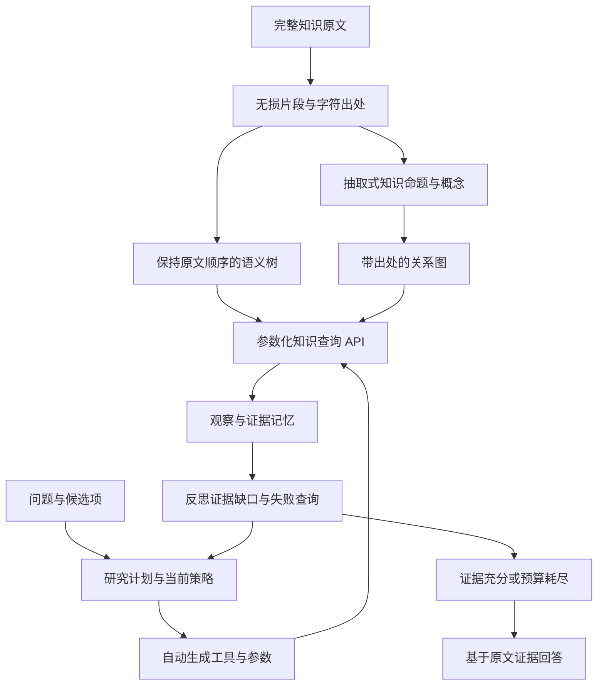

# RePAR 算法与执行协议

## 数据结构



片段 `C_i=[start_i,end_i)` 按字符连续覆盖全文，不使用答案或问题决定边界。每个片段关联一个知识节点 `K_i`，节点保存最多三个显著原文命题、TF-IDF 概念和逻辑提示。命题自身也带字符范围。

树节点 `T_j` 覆盖连续叶片区间 `[lo_j,hi_j)`，内部节点用子节点的稀疏归一化向量作为话题表示。分割点在近似均衡分位点附近选择相邻相似度较低的位置，保持顺序并控制树高。

图边表示共享实体、共享概念、词汇关联或原文相邻，并保留两端证据 ID。因果、对比、时间提示从原文抽取，供后续 LLM 阅读判断；它们不是经外部验证的逻辑结论。初版以高效、可追溯和无额外模型依赖为目标，神经向量、实体归一化和 LLM 命题抽象可以替换为同一 API 的后端。

## 查询算子

| API | 参数 | 功能 |
|---|---|---|
| `tree_browse` | `node`, `top_k` | 查看当前区间的话题和有序子树 |
| `tree_search` | `query`, `top_k`, `scope`, `beam_width`, `mode` | 在指定子树内进行层次路由和证据排序 |
| `graph_search` | `query`, `seeds`, `hops`, `top_k`, `relations` | 从知识节点出发寻找跨位置相关证据 |
| `read` | `ids`, `radius` | 回读准确原文及邻近片段 |

树搜索的 beam 按与 query 的稀疏余弦相似度剪枝，再以 BM25 排序叶片。`hybrid` 模式允许两个全局倒排检索候选作为补充；`tree` 模式只返回树路由候选。图搜索按 query 匹配度、边强度和路径衰减排序，最多三跳，限制每层前沿和返回量。

设叶片数为 n、总稀疏非零项数为 z、beam 为 b、fanout 为 f、返回数量为 k：树存储与节点数线性相关；理想均衡路由访问约 O(b f log_f n) 个节点，但极端边界下不能保证严格的对数界。BM25 扫描查询词的倒排项。当前图建边使用分块稀疏相似度，最坏仍可能 O(n²)，内存通过 block 限制；它不是任意规模下严格线性的 ANN 构建器。每个节点额外保留有限近邻与实体桥接。

完整查询还包含 Python 基线实现的开销：BM25 使用全长分数数组并对 scope 中叶片排序，图的 query 匹配也计算全文叶片的稀疏矩阵乘积。因此不能把整次查询宣称为严格 O(log n)。本次规模下的毫秒级延迟是实测结果，不能外推为海量语料库的复杂度保证。

## 自动编排与任务内自进化

令任务状态为 `S_t=(q,M_t,H_t,π_t,B_t)`：`q` 为问题与候选项，`M_t` 为带出处的证据记忆，`H_t` 为真实执行历史，`π_t` 为当前查询策略文本，`B_t` 为剩余轮数预算。控制器生成 `a_t={(operator,parameters)}`、反思与修订后的 `π_(t+1)`；执行器返回 `o_t`，再按 `M_(t+1)=merge(M_t,o_t)` 保留证据，形成下一轮状态。这使检索轨迹随观察变化，而不是预设“树一次、图一次”的固定流水线。

控制器的工作目标是补足能够区分选项的证据，并检查反例；当前原型没有实现经过训练的置信度校准或显式信息增益奖励。因此“证据充分”是模型提出的停止意见，必须与出处和运行轨迹一起审查，不能当作已证明的完备性判定。

每轮控制器从问题、树/图规模、当前证据、前轮计划和观察中选择下一步：

```json
{
  "reflection": "已有一个时期的策略证据，仍缺后续时期及反例",
  "plan": "从现有知识节点扩展，并查询后续时期的变化",
  "policy_update": {"focus": "第二时期及反例", "strategy": "实体桥接加针对性树查询"},
  "tool_calls": [
    {"name": "graph_search", "parameters": {"query": "later strategy", "seeds": ["K12"], "hops": 2, "top_k": 8}}
  ],
  "finish": false
}
```

此 JSON 是可执行工具协议，dispatcher 只允许已注册算子。失败参数产生观察，反馈给下一轮；没有证据时禁止直接结束。证据记忆按第一次召回的相对排名和轮次保留原文，受总词数预算约束。每次策略修正都会保留在可审查的完整轨迹中。

针对 0.8B 控制器，使用有界 JSON Schema 限制字段长度与参数域。若同时生成 `finish:true` 和工具调用，先执行工具；完全相同的成功调用会被拒绝，重复错误及修订建议送回控制器。至少完成两轮含原文结果的取证后，才接受空调用列表的主动结束信号；最多 5 轮后强制进入作答。若一直没有获得任何原文，使用显式记录的确定性树查询回退。这些防护保证可执行性，不保证小模型能有效修订策略；报告单列重复错误、有效取证轮数、图访问及预算耗尽比例。

这实现的是单题内 workflow 与 retrieval policy 的迭代修正。更强的跨任务 RSI 需要单独的训练/开发集合、独立评估和版本回退机制；当前实验没有将 benchmark 标准答案用于经验累积、提示调参或策略训练。

## 可复用的知识存储契约

概念上，知识库可写为 `KB=(C,K,T,E,P)`：`C` 是无损片段，`K` 是命题与概念，`T` 是有序树，`E` 是带类型的候选关联，`P` 保存原文字符出处以及片段与知识节点的映射。当前 `C_i ↔ K_i` 为一对一，`K_i` 内含至多三个命题；更细的原子命题节点或同义合并可以通过后端扩展，不能假称本实验已经使用。

所有查询返回 `C_i`、`K_i`、树路径、字符范围与原文，图结果另含桥接端点、边类型和深度。`read` 可扩展邻居以恢复片段边界附近的上下文。最终答案依据原文，概念与图边只负责定位。索引缓存键包含完整原文 SHA256 和结构参数版本；LLM 请求缓存另含部署标识，MTP 同权重开关不会互相命中。

知识库导出使用 `python scripts/query_kb.py --context knowledge.txt --tool tree_browse --params '{"node":"T0"}' --export artifacts/knowledge.json`，保存树、叶片区间、知识命题和所有边；它适用于独立知识文本，无需 LongBench 的问题和答案。实际查询 API 是 Python 方法和 JSON dispatcher，当前没有额外 HTTP 检索服务层。

## 实验隔离

评测器剥离 `answer` 后才调用检索器和 agent。所有索引直接以完整 context 的哈希缓存，可以跨同文问题复用。标准答案仅用于结果文件中计算 exact-match accuracy。四组主实验使用相同数据顺序、底座、采样设置和答案解析，不按成绩选择有利子集。

完整 RePAR 和去图条件使用相同控制器 prompt、工具描述、轮数与生成上限，去图条件在 dispatcher 处阻断 `graph_search` 并反馈错误。首次图访问前的状态相同，可以复用完全一致的请求缓存；未尝试图访问的题可有完全相同的轨迹。这是图访问能力被阻断的受控消融，不是重新设计无图控制器的成绩；实际调用数量仍由控制器决定，并非精确控制每题推理 token 数的消融。BM25 是单轮非 agent 检索基线。提升可能同时来自检索质量和额外推理计算，报告分别给出成本与成绩。
