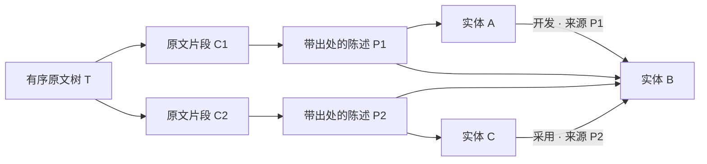

# RePAR v2：实体知识图与通用研究控制器

后续复核与待实现方案见[下一版通用层优化提案](REPAR_V3_PROPOSAL.md)。该提案明确区分v2现有能力、独立案例复现的契约问题及尚未验证的改进，不改写本版本历史实现或成绩。

v2 将两个此前混淆的层面分开：树定位原文片段，图索引实体及实体之间的抽取关系；规划、动作、观察、反思则在真实执行边界上交替。v1 的代码和配置保存在 `artifacts/versions/v1/`，原始实验与页面证据仍保留。

## 参考与采用范围

| 来源 | 核心思想 | v2 的采用方式与边界 |
|---|---|---|
| [ReAct, Yao et al.](https://arxiv.org/html/2210.03629) | 推理与外部动作交替；观察帮助更新计划、处理例外 | `plan → action → observation → reflection → next plan`。原文并不要求每阶段独立一次模型调用；这里为明确执行边界与适配小模型采用独立调用，成本单列 |
| [Reflexion, Shinn et al.](https://arxiv.org/html/2303.11366v4) | Actor、Evaluator、Self-reflection 与记忆，通过语言反馈改进后续尝试 | 保存真实工具结果、失败和策略 lesson，作为后续规划状态；没有测试答案反馈，没有权重学习，也不声称完整复现其跨尝试训练流程 |
| [IRCoT, Trivedi et al.](https://arxiv.org/html/2212.10509) | 检索结果影响后续推理，推理形成新的检索需要 | 当前 evidence gap 决定下一步 query，而不是始终重复原始任务 |
| [Self-RAG, Asai et al.](https://arxiv.org/html/2310.11511) | 判断检索必要性、证据相关性和支持度 | 反思区分实际支持与缺口，并允许回答/继续。原工作训练专用 reflection tokens；本项目没有这项训练，不能把提示式反思称为 Self-RAG 复现 |

下载的论文文本位于 `third_party/papers/`。ReAct 的 Thought/Action/Observation 启发了控制边界；对外记录简短计划与证据评估，不要求完整长篇推理轨迹。

## 两层知识结构

`C` 保存无损字符区间；`P` 是解析后的原文句子；`E` 是命名实体或名词概念；`R=(subject,predicate,object,qualifiers,provenance)` 是从依存结构抽取的关系。一个片段映射多个实体，一个实体有多个提及、陈述和片段出处。图不是一片段一个知识节点的重命名，也不再沿片段 TF-IDF 近邻当作实体邻居。

实体归一化使用词形还原和去除冠词，合并相同规范短语，保留不同表面别名。它不自动断言两个不同名字是同一实体，不实现任意跨文档指代消解。抽取后端是本地 spaCy `en_core_web_sm` 的 NER、名词短语和依存解析，属于可替换的英语后端；图存储/API/研究控制器不依赖 LongBench 或四选一题型。其他语言可替换解析后端，不能宣称本英语解析器已覆盖所有语言。

关系区分有向 predicate 与较弱的 co_mention。被动语态在可识别施事时转换方向；保留否定、情态和句内时间信息。例如“机构 C 没有采用项目 B”不会与“机构 C 采用项目 B”合并成同一肯定关系。每条关系回溯到原文 `P`、`C` 和字符出处。依存抽取仍会犯错，关系标记 `automatically_extracted_not_verified`；图路径是查找证据的桥梁，不是可无条件串联的逻辑证明。

## 参数化 API

| API | 作用 |
|---|---|
| `tree_search(query, scope, beam_width, mode, top_k)` | 在有序树中定位原始片段，结果附带实体 IDs |
| `tree_browse(node, top_k)` | 查看来源组织与子树 |
| `read(ids, radius)` | 回读准确原文和邻近片段 |
| `graph_entities(query, top_k)` | 在独立的实体索引中检索名称、概念及有出处的陈述，返回 E IDs |
| `graph_neighbors(seeds, query, hops, kinds, direction, top_k, exclude_passages)` | 从实体出发按方向和关系种类遍历邻居，回收跨片段陈述与原文，返回关系、路径和出处 |

实体提及本身也能跨片段聚合同一对象的信息。例如先检索“Delta Commission 开发 Silver Protocol”，再从 Silver Protocol 的 incoming 关系找出“Harbor Council 采用 Silver Protocol”；结果保留两个独立原文出处。

## 通用控制协议

控制器只接收 `task`、source evidence、工具 catalog、历史观察和执行预算。它不知道数据集名称、标准答案、固定领域、选项数量或评分方式。`agent_v2.py` 是独立的 LongBench 适配层，负责把题目/选项转成 task 以及最后答案的官方格式。

1. Plan：生成当前目标和搜索 query，读取上一轮真实 observation 与 lesson。
2. Action：选择一个符合 plan 的参数化 API。执行器将已存在的实体、片段和树节点绑定到候选调用中；模型选择工具、seed、scope 等候选，不生成未经观察的节点名。
3. Observation：先执行工具，再记录返回的实体、关系、路径、原文、新证据和耗时。
4. Reflection：另一次模型调用读取实际返回内容，评估支持、信息缺口和策略 lesson，选择回答或继续。下一轮 plan 读取这份反思。

候选动作由当前 query、可用工具和已经观察到的节点生成；没有“必须先树后图”“必须使用图”“必须检索两轮”等路线规定。图不可用的消融从工具 catalog 中移除图接口，而不是诱导控制器调用后返回错误。

候选参数绑定属于执行层校验，不替模型选择下一步动作。它是参数化 API 的受约束生成：防止 `Paper 1`、`Cn` 等字符串被用作实体 ID。候选默认提供有界的 top_k、hops 和邻居方向，面向通用知识检索，未用测试答案选参数。

图遍历按固定顺序输出关系与实体，避免 Python 集合的进程哈希随机性影响后续提示。结构化输出失败时允许最多两次格式修复，最后一次仅扩大完整 JSON 的输出空间；修复前不重复执行工具。该格式问题和排序问题在全量运行中被发现，旧中间记录已归档，稳定版本重新执行全部条件。因此本轮属于迭代开发验证，不应称为严格的预注册确认实验。

重复防护前移：已经完成的规范化调用不再进入下一轮候选；极近似的同参数 query 也去重。没有产生新证据/新实体的动作会累积无进展计数，达到预算便明确结束为 `no_progress`，而不是反复执行报错。终止只有一个动作或 reflection 意见，不同时输出互相冲突的 finish 与 tool_calls。不要求最少取证轮数，简单任务可以一次取证后结束。

## 实验与解释限制

标准 Q4、关闭 MTP；v2 新建图并运行全部 125 题的 RePAR 和无图对照。直接回答/BM25 复用先前同底座、同来源片段的实测记录，来源和配置分别记录，不能伪装为新运行。v1 成绩已知，因此这不是完全未见测试集的新实验；协议验证使用另外构造的通用合成文本，不把测试答案写进提示或做逐题规则。

图抽取在完整 context 上离线进行，包含解析成本；在线日志单列工具耗时、LLM 调用和完整墙钟时间。结构审计核对所有实体提及、陈述、关系端点和原文出处。最终准确率、真实图访问和预算耗尽情况按完整运行报告，不能仅凭结构更丰富宣称有效。

复现：`python scripts/build_indexes_v2.py`；`python scripts/run_v2.py`；`python -m pytest tests/test_v2.py -q`。v2 配置为 `configs/repar_v2.json`，索引/结果/轨迹分别写入带 v2 的独立目录。

安装解析后端：`python -m pip install -e ".[graph]"`，再运行 `python -m pip install https://github.com/explosion/spacy-models/releases/download/en_core_web_sm-3.8.0/en_core_web_sm-3.8.0-py3-none-any.whl`。生成式底座仍只有本机标准 Q4；额外的小型 CPU 模型是语言解析器，不是替代底座的大模型。

在独立知识库使用：`python scripts/research_kb.py --context knowledge.txt --task "你的研究任务"`。该入口不需要数据集、选项和标准答案。仅查询实体/关系可使用 `scripts/query_kb_v2.py`。
